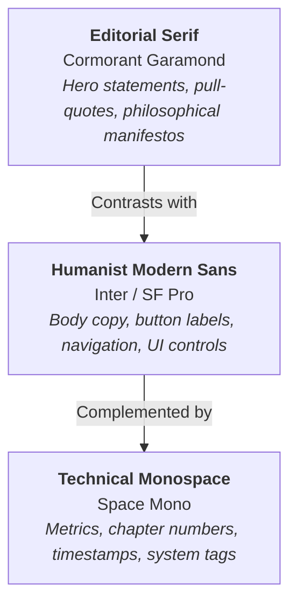

# Apple Titanium × Swiss Minimalist Design System
### Master Specification, Engineering Tokens & AI Replication Framework

> **Designed for**: High-impact portfolios, executive B2B tech sites, creative director showcases, and modern luxury web applications.  
> **Aesthetic DNA**: Apple Cupertino precision, Swiss graphic design grid discipline, OLED black canvas, razor-sharp hairline borders, and tactile spring physics.

---

## Table of Contents
1. [Core Design Philosophy](#1-core-design-philosophy)
2. [Design Tokens & Variables](#2-design-tokens--variables)
   - [Color Palettes (Dark & Light)](#color-palettes)
   - [Border & Surface Elevation](#border--surface-elevation)
   - [Shadow & Depth System](#shadow--depth-system)
   - [Squircle Radii & Geometric Curves](#squircle-radii)
3. [Typography Hierarchy & Font Triad](#3-typography-hierarchy--font-triad)
   - [Font Scale & Fluid Clamp Formulas](#font-scale--fluid-formulas)
   - [Tracking & Letter-Spacing Rules](#tracking--letter-spacing-rules)
4. [Spacing, Grid & Layout Architecture](#4-spacing-grid--layout-architecture)
   - [The 8pt Spatial Scale](#the-8pt-spatial-scale)
   - [Container & Responsive Breakpoints](#container--responsive-breakpoints)
5. [Ergonomic Component Specifications](#5-ergonomic-component-specifications)
   - [Apple Ergonomic Button Scale](#apple-ergonomic-button-scale)
   - [Narrative Chapter Indicators](#narrative-chapter-indicators)
   - [Curatorial Director's Badges](#curatorial-directors-badges)
   - [Frosted Glass Cards & Surface Treatments](#frosted-glass-cards)
   - [Interactive Metrics & Counters](#interactive-metrics--counters)
   - [Media Showcases & Lightbox Architecture](#media-showcases)
6. [Motion, Physics & Animation System](#6-motion-physics--animation-system)
   - [Apple Spring Curves](#apple-spring-curves)
   - [Lenis Smooth Scroll & GSAP Integration](#lenis--gsap-integration)
   - [Magnetic Cursor & Hover Physics](#magnetic-cursor)
7. [The 6-Act Narrative Architecture](#7-the-6-act-narrative-architecture)
8. [Copywriting & Voice Guidelines](#8-copywriting--voice-guidelines)
9. [AI Model Prompting & Replication Templates](#9-ai-model-prompting--replication-templates)
   - [System Prompt for AI Coding Assistants](#system-prompt-for-ai-coding-assistants)
   - [Component Generation Prompt](#component-generation-prompt)
   - [Design Audit & Critique Prompt](#design-audit--critique-prompt)

---

## 1. Core Design Philosophy

This design system is built around three inviolable principles:

1. **Extreme Editorial Restraint**: No decorative gradients, no unnecessary neon glows, no arbitrary borders. Every pixel must justify its presence. White space (negative space) is not empty; it is cognitive breathing room that commands authority.
2. **Tactile Apple Physics**: Micro-interactions must feel mechanical, snappy, and organic. Transitions emulate physical inertia using custom spring cubic-beziers (`cubic-bezier(0.16, 1, 0.3, 1)`). Buttons compress under pressure (`scale(0.98)`), surfaces refract ambient light, and cards respond to cursor proximity.
3. **Swiss Grid Modernism**: Visual hierarchy is mathematically anchored. Content flows logically along proportional columns, serif headlines provide editorial elegance, sans-serif body copy guarantees universal legibility, and monospace accents inject technical rigor.

---

## 2. Design Tokens & Variables

Copy and paste this CSS custom properties block into the root of any project:

```css
:root {
  /* ==========================================================================
     1. COLOR PALETTE — TITANIUM OLED DARK (DEFAULT)
     ========================================================================== */
  --bg-primary: #000000;                      /* Pure OLED Black */
  --bg-surface: #0e0e11;                      /* Deep Titanium Surface */
  --bg-surface-2: #16161a;                    /* Elevated Surface Layer */
  --bg-surface-card: rgba(255, 255, 255, 0.035); /* Translucent Glass Card */
  --bg-surface-card-hover: rgba(255, 255, 255, 0.065);
  --bg-navbar: rgba(14, 14, 17, 0.78);        /* Frosted Nav Backdrop */
  --bg-glass: rgba(24, 24, 28, 0.72);
  --bg-pill: rgba(255, 255, 255, 0.07);
  --bg-pill-active: #f5f5f7;
  --bg-backdrop: rgba(0, 0, 0, 0.82);

  /* Typography Colors */
  --text-primary: #f5f5f7;                    /* Soft Silk White (Non-glaring) */
  --text-muted: #86868b;                      /* Apple Secondary Titanium Gray */
  --text-tertiary: #6e6e73;                   /* Subtle Tertiary Metadata */
  --text-dark: #000000;                       /* Deep Invert Contrast */
  --text-stroke: rgba(255, 255, 255, 0.12);

  /* Accents & Highlights */
  --accent: #f5f5f7;                          /* Primary Titanium White */
  --accent-light: #ffffff;
  --accent-dark: #86868b;
  --accent-cyan: #2997ff;                     /* Cupertino Hyper-Blue */
  --accent-gradient: linear-gradient(135deg, #f5f5f7 0%, #a1a1a6 100%);

  /* Hairline Specular Borders */
  --border: rgba(255, 255, 255, 0.09);       /* Hairline Border */
  --border-hover: rgba(255, 255, 255, 0.22); /* Active Interaction Border */
  --border-focus: rgba(255, 255, 255, 0.45);
  --border-subtle: rgba(255, 255, 255, 0.05);
  --chart-fill: rgba(255, 255, 255, 0.08);

  /* Depth & Shadows */
  --shadow-card: 0 4px 20px rgba(0, 0, 0, 0.4);
  --shadow-hover: 0 20px 48px rgba(0, 0, 0, 0.65), 0 0 0 1px rgba(255, 255, 255, 0.12);
  --shadow-glass: 0 16px 40px rgba(0, 0, 0, 0.5), inset 0 1px 0 rgba(255, 255, 255, 0.1);
  --shadow-theater: 0 32px 80px rgba(0, 0, 0, 0.9), 0 0 0 1px rgba(255, 255, 255, 0.1);

  /* Typography Triad */
  --font-serif: 'Cormorant Garamond', Georgia, serif;
  --font-mono: 'Space Mono', Courier, monospace;
  --font-sans: 'Inter', -apple-system, BlinkMacSystemFont, "SF Pro Display", "Segoe UI", Roboto, sans-serif;

  /* Squircle Border Radii */
  --radius-sm: 8px;
  --radius-md: 14px;
  --radius-lg: 22px;
  --radius-xl: 28px;
  --radius-full: 9999px;

  /* Modular Spacing (8pt Scale) */
  --spacing-xs: 0.25rem;   /* 4px */
  --spacing-sm: 0.5rem;    /* 8px */
  --spacing-md: 1rem;      /* 16px */
  --spacing-lg: 1.5rem;    /* 24px */
  --spacing-xl: 2rem;      /* 32px */
  --spacing-2xl: 3rem;     /* 48px */
  --spacing-3xl: 4.5rem;   /* 72px */
  --spacing-4xl: 6rem;     /* 96px */

  /* Apple Spring & Inertia Curves */
  --ease-apple: cubic-bezier(0.25, 1, 0.5, 1);
  --ease-spring: cubic-bezier(0.16, 1, 0.3, 1);
  --transition-fast: 160ms var(--ease-apple);
  --transition-base: 280ms var(--ease-apple);
  --transition-slow: 500ms var(--ease-apple);
  --transition-smooth: 800ms var(--ease-spring);
}

/* ==========================================================================
   2. LIGHT MODE OVERRIDES (Apple Off-White Studio)
   ========================================================================== */
[data-theme="light"] {
  --bg-primary: #fbfbfd;                     /* Apple Studio Canvas */
  --bg-surface: #ffffff;                     /* Clean White Surface */
  --bg-surface-2: #f5f5f7;                   /* Soft Titanium Grey */
  --bg-surface-card: #ffffff;
  --bg-surface-card-hover: #ffffff;
  --bg-navbar: rgba(251, 251, 253, 0.82);
  --bg-glass: rgba(255, 255, 255, 0.85);
  --bg-pill: rgba(0, 0, 0, 0.05);
  --bg-pill-active: #1d1d1f;
  --bg-backdrop: rgba(0, 0, 0, 0.45);

  --accent: #1d1d1f;                         /* Obsidian Slate */
  --accent-light: #000000;
  --accent-dark: #86868b;
  --accent-cyan: #0071e3;                    /* Crisp Apple Blue */
  --accent-gradient: linear-gradient(135deg, #1d1d1f 0%, #515154 100%);

  --text-primary: #1d1d1f;
  --text-muted: #86868b;
  --text-tertiary: #a1a1a6;
  --text-dark: #ffffff;

  --border: rgba(0, 0, 0, 0.08);
  --border-hover: rgba(0, 0, 0, 0.18);
  --border-focus: rgba(0, 0, 0, 0.35);
  --border-subtle: rgba(0, 0, 0, 0.04);
  --text-stroke: rgba(0, 0, 0, 0.1);
  --chart-fill: rgba(0, 0, 0, 0.06);

  --shadow-card: 0 4px 20px rgba(0, 0, 0, 0.05);
  --shadow-hover: 0 16px 36px rgba(0, 0, 0, 0.1), 0 0 0 1px rgba(0, 0, 0, 0.08);
  --shadow-glass: 0 12px 32px rgba(0, 0, 0, 0.08), inset 0 1px 0 rgba(255, 255, 255, 0.8);
}
```

---

## 3. Typography Hierarchy & Font Triad

The system uses a strict **Three-Tier Font Triad** to balance human warmth, precision, and technical credibility:



### Font Scale & Fluid Formulas
Use `clamp()` for headline fluidity across phone, tablet, and ultra-wide screens:

| Element | Size / Clamp Formula | Weight | Tracking / Letter Spacing | Line Height | Font Family |
| :--- | :--- | :--- | :--- | :--- | :--- |
| **Hero Display** | `clamp(2.5rem, 5.5vw, 4.25rem)` | 800 / 900 | `-0.035em` | 1.08 | Inter / Serif Mix |
| **Section Title** | `clamp(1.75rem, 3.5vw, 2.75rem)` | 700 | `-0.025em` | 1.15 | Inter |
| **Subsection** | `clamp(1.25rem, 2vw, 1.625rem)` | 600 | `-0.015em` | 1.30 | Inter |
| **Editorial Quote** | `clamp(1.2rem, 2.2vw, 1.75rem)` | 400 / 500 italic | `0.00em` | 1.45 | Cormorant Garamond |
| **Body Primary** | `1rem` (16px) | 400 | `-0.01em` | 1.65 | Inter |
| **Body Small** | `0.875rem` (14px) | 400 / 500 | `0.00em` | 1.55 | Inter |
| **System Label** | `0.75rem` (12px) | 600 / 700 | `+0.08em` to `+0.15em` | 1.00 | Space Mono / Inter |
| **Chapter Numbers** | `0.6875rem` (11px) | 700 | `+0.14em` | 1.00 | Space Mono |

### Tracking & Letter-Spacing Rules
- **Negative Tracking (`-0.02em` to `-0.04em`)**: Applied to all headlines $> 24\text{px}$. Tightens optical spacing for authoritative presence.
- **Positive Tracking (`+0.08em` to `+0.15em`)**: Applied to all uppercase metadata, badges, and monospace counters. Prevents cramped scanning.

---

## 4. Spacing, Grid & Layout Architecture

### The 8pt Spatial Scale
All margins, paddings, and component heights align to multiples of **8px** (with 4px for micro-adjustments):
- `4px` (xs): Hairline offsets, dot margins, icon gaps.
- `8px` (sm): Badge padding, inner pill spacing, tight icon gaps.
- `16px` (md): Standard card internal padding, list item gaps.
- `24px` (lg): Large card inner padding, grid gutters.
- `32px` (xl): Section header bottom margins, stack separation.
- `48px` (2xl): Container gap, intra-section division.
- `72px` (3xl): Standard section vertical padding (mobile).
- `96px`–`120px` (4xl): Desktop section padding (`padding: clamp(4.5rem, 8vw, 7.5rem) 0;`).

### Container & Layout Rules
```css
.container {
  width: 100%;
  max-width: 1240px;
  margin-left: auto;
  margin-right: auto;
  padding-left: clamp(1rem, 3.5vw, 2.25rem);
  padding-right: clamp(1rem, 3.5vw, 2.25rem);
}
```

---

## 5. Ergonomic Component Specifications

### Apple Ergonomic Button Scale

Buttons follow three strict ergonomic size tiers. Never create arbitrary button dimensions:

| Variant | Height | Padding (X) | Font Size | Border Radius | Best Used For |
| :--- | :--- | :--- | :--- | :--- | :--- |
| **`.btn-sm`** | **32px** | `14px` | `0.75rem` (12px) | `var(--radius-full)` | Tags, quick video triggers, contact pills, card secondary links |
| **`.btn-md`** | **40px** | `20px` | `0.8125rem` (13px) | `var(--radius-full)` | Section actions, modal downloads, form submissions, filter pills |
| **`.btn-lg`** | **46px** | `24px` | `0.875rem` (14px) | `var(--radius-full)` | Primary Hero CTAs, main conversion triggers |

#### Base Button CSS:
```css
.btn {
  display: inline-flex;
  align-items: center;
  justify-content: center;
  gap: 8px;
  height: 40px;
  padding: 0 20px;
  font-family: var(--font-sans);
  font-size: 0.8125rem;
  font-weight: 500;
  line-height: 1;
  text-decoration: none;
  white-space: nowrap;
  border-radius: var(--radius-full);
  cursor: pointer;
  border: 1px solid transparent;
  transition: all var(--transition-fast);
  user-select: none;
  -webkit-tap-highlight-color: transparent;
}

/* Modifiers */
.btn-sm { height: 32px; padding: 0 14px; font-size: 0.75rem; }
.btn-md { height: 40px; padding: 0 20px; font-size: 0.8125rem; }
.btn-lg { height: 46px; padding: 0 24px; font-size: 0.875rem; font-weight: 600; }

/* Styles */
.btn-primary {
  background-color: var(--text-primary);
  color: var(--bg-primary);
  border-color: var(--text-primary);
}
.btn-primary:hover {
  opacity: 0.92;
  transform: translateY(-1px);
  box-shadow: 0 6px 20px rgba(255, 255, 255, 0.14);
}
.btn-primary:active {
  transform: scale(0.98);
}

.btn-secondary {
  background-color: rgba(255, 255, 255, 0.05);
  color: var(--text-primary);
  border-color: var(--border);
  backdrop-filter: blur(12px);
}
.btn-secondary:hover {
  background-color: rgba(255, 255, 255, 0.09);
  border-color: var(--border-hover);
  transform: translateY(-1px);
}
.btn-secondary:active {
  transform: scale(0.98);
}

.btn-ghost {
  background: transparent;
  color: var(--text-muted);
  border-color: transparent;
}
.btn-ghost:hover {
  color: var(--text-primary);
  background: rgba(255, 255, 255, 0.05);
}
```

---

### Narrative Chapter Indicators
The site structure is framed like an editorial cinematic screenplay. Use `.journey-chapter-tag` at the top of every major section:

```html
<div class="journey-chapter-tag reveal-item">
  <span class="chapter-dot"></span>
  <span class="chapter-num">ACT I</span>
  <span class="chapter-sep">/</span>
  <span class="chapter-title">The Manifesto &amp; Convergence</span>
</div>
```

```css
.journey-chapter-tag {
  display: inline-flex;
  align-items: center;
  gap: 7px;
  padding: 4px 12px;
  background: rgba(255, 255, 255, 0.04);
  border: 1px solid var(--border);
  border-radius: var(--radius-full);
  font-family: var(--font-mono);
  font-size: 0.6875rem;
  letter-spacing: 0.12em;
  text-transform: uppercase;
  color: var(--text-muted);
  margin-bottom: 1.25rem;
}

.chapter-dot {
  width: 5px;
  height: 5px;
  border-radius: 50%;
  background: var(--accent-cyan);
  box-shadow: 0 0 8px var(--accent-cyan);
}

.chapter-num {
  color: var(--text-primary);
  font-weight: 700;
}
```

---

### Curatorial Director's Badges
Used for video cards, project showcases, and technical callouts to explain production intent:

```html
<div class="directors-note-badge">
  <span class="directors-label">Director's Note</span>
  <span class="directors-spec">4K · 24fps · DaVinci Film Print Grade</span>
</div>
```

```css
.directors-note-badge {
  display: flex;
  align-items: center;
  justify-content: space-between;
  padding: 8px 14px;
  background: rgba(0, 0, 0, 0.65);
  backdrop-filter: blur(16px);
  border: 1px solid rgba(255, 255, 255, 0.08);
  border-radius: var(--radius-sm);
  font-family: var(--font-mono);
  font-size: 0.6875rem;
}
.directors-label {
  color: var(--accent-cyan);
  text-transform: uppercase;
  font-weight: 700;
  letter-spacing: 0.08em;
}
.directors-spec {
  color: var(--text-muted);
}
```

---

### Frosted Glass Cards & Surface Treatments
High-end glassmorphism must never look washed out or milky. It requires a triple-layer setup:
1. Low-opacity dark base (`rgba(255, 255, 255, 0.035)`).
2. High-blur backdrop filter (`backdrop-filter: blur(20px)`).
3. Hairline top specular border (`border: 1px solid rgba(255, 255, 255, 0.08)`).

```css
.glass-card {
  background: var(--bg-surface-card);
  border: 1px solid var(--border);
  border-radius: var(--radius-lg);
  backdrop-filter: blur(20px);
  -webkit-backdrop-filter: blur(20px);
  box-shadow: var(--shadow-card);
  padding: clamp(1.5rem, 3vw, 2.5rem);
  transition: transform var(--transition-base), border-color var(--transition-base), box-shadow var(--transition-base);
}

.glass-card:hover {
  border-color: var(--border-hover);
  box-shadow: var(--shadow-hover);
  transform: translateY(-2px);
}
```

---

## 6. Motion, Physics & Animation System

### Apple Spring Curves
Avoid standard CSS `ease` or linear motion. Use the calibrated Apple spring curve:

```css
:root {
  --ease-apple: cubic-bezier(0.25, 1, 0.5, 1);
  --ease-spring: cubic-bezier(0.16, 1, 0.3, 1);
}
```

- When hover begins: fast initial acceleration (`0.16`), smooth settling (`1.0`).
- No rubber-band overshoot for UI elements; preserve serious corporate elegance.

### Lenis Smooth Scroll & GSAP Integration
The ultimate smooth-scroll pairing locks the scroll during preloader, syncs with GSAP's internal ticker, and handles reduced motion automatically:

```javascript
import Lenis from 'lenis';
import gsap from 'gsap';
import ScrollTrigger from 'gsap/ScrollTrigger';

gsap.registerPlugin(ScrollTrigger);

const prefersReducedMotion = window.matchMedia("(prefers-reduced-motion: reduce)").matches;

let lenis;
if (!prefersReducedMotion) {
  lenis = new Lenis({
    duration: 1.2,
    easing: (t) => Math.min(1, 1.001 - Math.pow(2, -10 * t)),
    smoothWheel: true,
    smoothTouch: false,
    touchMultiplier: 1.4
  });

  // Sync with GSAP Ticker
  gsap.ticker.add((time) => {
    lenis.raf(time * 1000);
  });
  gsap.ticker.lagSmoothing(0);

  lenis.on('scroll', ScrollTrigger.update);
}
```

---

## 7. The 6-Act Narrative Architecture

Structure comprehensive portfolios and landing pages as a structured 6-Act narrative:

| Act | Title | Narrative Intent | Key Components |
| :--- | :--- | :--- | :--- |
| **Act I** | *The Manifesto & Convergence* | Establish the individual's core thesis immediately. Proof of gravity at first glance. | Giant headline with editorial serif accent, quantitative KPI ticker, authoritative primary CTA cluster. |
| **Act II** | *The Creative Odyssey* | Reveal the human journey, core disciplines, and chronological evolution. | 3 Discipline pillars (Film Direction, Brand Architecture, Growth Engine), 2021–Present milestone timeline. |
| **Act III** | *Proof of Strategy* | Tangible corporate client results with ROI metrics. | Asymmetric Bento Case Study cards (Devon SaaS, JudicAI, Wana Luxury, Stone Oak). |
| **Act IV** | *The Cinematic Eye* | Sensory video mastery, pacing, color science, and rhythm. | Responsive 16:9 & 9:16 video grid, Director's Notes on lighting/grading, instant full-theater modal. |
| **Interlude** | *The Director's Blueprint* | Demystify execution. Show clients and employers *how* you deliver. | 4-Stage methodology: 01 Blueprint, 02 On-Set Command, 03 Editorial Alchemy, 04 Market Deployment. |
| **Act V** | *The Architecture* | Swiss brand identity system and downloadable strategic decks. | 10-slide interactive inspector, embedded PDF executive whitepaper, downloadable DOCX strategy. |
| **Act VI** | *The Discipline & Commission* | Remove friction for high-value contracts or employment inquiries. | Hard skills inventory, interactive contact form, direct one-click WhatsApp/Email/LinkedIn channels. |

---

## 8. Copywriting & Voice Guidelines

1. **Active & Decisive**: Never write *"I helped with video editing"*. Write *"Directed and edited high-retention commercial campaigns driving 450K+ organic impressions"*.
2. **Quantitative Validation**: Every claim should feature a metric: conversion lift ($+40\%$), audience reach ($4.2\text{M}$), ROAS ($3.2\times$), or delivery rate ($100\%$).
3. **Restrained Confidence**: Avoid exclamation marks, informal slang, or buzzwords like "ninja" or "guru". Speak like an established Swiss design bureau or an Apple keynote speaker.

---

## 9. AI Model Prompting & Replication Templates

Copy and use these exact prompts across **Claude 3.5 Sonnet**, **GPT-4o**, **Gemini 1.5 Pro**, **Cursor**, or **Antigravity**.

---

### Template 1: System Prompt for AI Coding Assistants
*Add this to your `.cursorrules`, project custom instructions, or AI system prompt:*

```markdown
You are an expert Frontend Architect and Design Systems Engineer adhering strictly to the "Apple Titanium × Swiss Minimalist" design standard.

Whenever you build, modify, or suggest UI components, web pages, or CSS, you must follow these rules:

1. Color & Canvas:
   - Primary dark canvas is pure OLED black (#000000), surface is #0e0e11, elevated card surface is rgba(255, 255, 255, 0.035).
   - Text colors: #f5f5f7 (silk white primary), #86868b (secondary titanium muted), #6e6e73 (tertiary).
   - Never use default blue (#0000ff). Use Cupertino hyper-blue (#2997ff) for subtle accent pings or active dots.
   - Borders must be hairline specular lines: 1px solid rgba(255, 255, 255, 0.09). Hover state: rgba(255, 255, 255, 0.22).

2. Typography:
   - Body & UI: 'Inter', -apple-system, BlinkMacSystemFont, "Segoe UI", sans-serif.
   - Editorial accents & hero manifestos: 'Cormorant Garamond', Georgia, serif (italic or regular).
   - Technical tags, chapter numbers, metrics: 'Space Mono', monospace.
   - Negative tracking on display headers (-0.02em to -0.04em). Positive tracking on uppercase metadata (+0.12em).

3. Ergonomic Buttons:
   - Always use the 3-tier ergonomic scale:
     * .btn-sm: 32px height, padding 0 14px, font-size 0.75rem.
     * .btn-md: 40px height, padding 0 20px, font-size 0.8125rem.
     * .btn-lg: 46px height, padding 0 24px, font-size 0.875rem, font-weight 600.
   - Border radius is always pill/squircle (border-radius: 9999px).
   - Active state has physical tap compression: transform: scale(0.98).

4. Physics & Animation:
   - Transitions use Apple spring curve: cubic-bezier(0.16, 1, 0.3, 1).
   - Glass cards use backdrop-filter: blur(20px) with 1px solid rgba(255, 255, 255, 0.08).
   - Code must respect `prefers-reduced-motion`.

5. Tone:
   - Authoritative, Swiss modernist, restrained luxury, quantitative metrics.
```

---

### Template 2: Component Generation Prompt
*Use this prompt when asking an AI to generate a specific new component or page section:*

```markdown
Create a [Insert Component Name, e.g., Pricing Table / Testimonial Carousel / Hero Section] following the Apple Titanium × Swiss Minimalist Design Standard:

Requirements:
- OLED black (#000000) background with frosted glass cards (rgba(255, 255, 255, 0.035), blur: 20px, border: 1px solid rgba(255, 255, 255, 0.09)).
- Follow the 3-tier typography triad: Cormorant Garamond for the title accent, Inter for body/labels, Space Mono for tags.
- Include a `.journey-chapter-tag` at the top with a glowing blue dot (#2997ff).
- Use strictly sized Apple ergonomic buttons (.btn-sm 32px, .btn-md 40px, or .btn-lg 46px).
- Provide pure, semantic HTML and self-contained CSS utilizing CSS variables.
```

---

### Template 3: Design Audit & Critique Prompt
*Use this prompt to audit any existing webpage or design mockup:*

```markdown
Audit the following code/page against the Apple Titanium × Swiss Minimalist Design Standard. Evaluate:
1. Button Ergonomics: Are button heights adhering strictly to 32px / 40px / 46px? Are paddings balanced?
2. Color Restraint: Is the dark palette pure OLED black (#000000) with soft titanium whites (#f5f5f7) and #86868b secondary grays, or does it have unnecessary purple/blue saturated tints?
3. Border Sophistication: Are borders subtle hairlines (1px solid rgba(255,255,255,0.09)) rather than chunky gray lines?
4. Typographic Hierarchy: Is there a clear distinction between editorial serif, modern sans-serif, and monospace accents?
5. Narrative Flow: Does the layout read like an executive story with chapter indicators and quantitative proof?

Provide specific code diffs to elevate the interface to Apple-grade standards.
```
